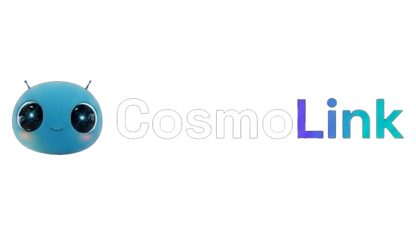

<div align="center">



# CosmoLink

**Il tuo universo in un solo link.**

Alternativa italiana gratuita a Linktree — crea la tua pagina link-in-bio personalizzata con temi spaziali, analytics reali e QR code con mascotte integrata.

[](https://nextjs.org)
[](https://supabase.com)
[](https://vercel.com)
[](https://typescriptlang.org)
[](https://cosmonet.info)

[🚀 Demo live](https://cosmo-link.vercel.app) · [📖 Documentazione](#come-funziona) · [🐛 Segnala un bug](#) · [💬 Contatto](https://wa.me/393517064080)

</div>

---

## 📸 Screenshot

> Pagina pubblica · Dashboard editor · Analytics · QR Code

---

## ✨ Funzionalità

### Piano Free
- ✅ Pagina pubblica personalizzata su `<dominio>/username`
- ✅ Fino a **5 link** con icone social auto-rilevate (150+ piattaforme)
- ✅ **Temi gratuiti** inclusi (i temi con `is_pro = false` nella tabella `themes`)
- ✅ Upload avatar (resize automatico 200×200px lato client)
- ✅ Link social nel profilo (Instagram, Twitter, YouTube, GitHub...)
- ✅ Analytics base: visite e click totali
- ✅ QR Code scaricabile con mascotte al centro (PNG 1024px)
- ✅ Blocchi separatori e intestazioni

### Piano PRO
- ⚡ **Link illimitati**
- ⚡ **Tutti i temi**, anche quelli esclusivi (`is_pro = true`)
- ⚡ Personalizzazione completa: sfondo, colori, font, stile bottoni, border radius
- ⚡ Embed video YouTube e Vimeo nella pagina pubblica
- ⚡ Link programmati (attivazione/disattivazione automatica per data)
- ⚡ Link in evidenza (Featured)
- ⚡ Analytics avanzate: paesi, dispositivi, breakdown per link
- ⚡ Rimozione branding "Powered by CosmoLink"
- ⚡ QR Code personalizzato (colori custom)

---

## 🛠️ Stack tecnologico

| Layer | Tecnologia |
|---|---|
| Framework | Next.js 16 (App Router) |
| Database | Supabase PostgreSQL |
| Auth | Supabase Auth (Email + Google OAuth) |
| Storage | Supabase Storage (avatar) |
| Styling | Tailwind CSS + CSS Variables |
| Drag & Drop | @dnd-kit |
| Grafici | Recharts |
| Icone UI | lucide-react |
| Icone brand | Simple Icons CDN |
| Animazioni | Framer Motion |
| QR Code | qrcode.react |
| Deploy | Vercel |
| Linguaggio | TypeScript (strict mode) |

---

## 🚀 Installazione locale

### Prerequisiti
- Node.js ≥ 18
- pnpm (`npm install -g pnpm`)
- Account Supabase (gratuito su [supabase.com](https://supabase.com))

### 1. Clona il repository

```bash
git clone https://github.com/CosmoNetinfo/CosmoLink.git
cd CosmoLink
```

### 2. Installa le dipendenze

```bash
pnpm install
```

### 3. Configura le variabili d'ambiente

Crea il file `.env.local` nella root del progetto:

```env
NEXT_PUBLIC_SUPABASE_URL=https://tuoprogetto.supabase.co
NEXT_PUBLIC_SUPABASE_ANON_KEY=la_tua_anon_key
SUPABASE_SERVICE_ROLE_KEY=la_tua_service_role_key
NEXT_PUBLIC_SITE_URL=http://localhost:3000
# Facoltative:
CRON_SECRET=un_segreto_lungo        # protegge /api/cron/keep-alive e i dettagli di /api/health
ADMIN_EMAILS=tua@email.it           # chi può aprire /dashboard/admin
NEXT_PUBLIC_MASCOT_URL=/mascot.png
NEXT_PUBLIC_MASCOT_LOGO_URL=/mascot-logo.png
```

> ⚠️ Non committare mai `.env.local` su Git — è già nel `.gitignore`

### 4. Configura il database Supabase

Vai su **Supabase Dashboard → SQL Editor** ed esegui i file in ordine:

```
supabase/migrations/001_profiles.sql
supabase/migrations/002_links.sql
supabase/migrations/003_tracking.sql
supabase/migrations/004_platforms.sql
supabase/migrations/005_themes.sql
supabase/migrations/006_storage.sql
supabase/migrations/007_seed_platforms.sql
supabase/migrations/008_seed_themes.sql
supabase/migrations/009_stripe_columns.sql
supabase/migrations/010_security_hardening.sql
```

### 5. Avvia il server di sviluppo

```bash
pnpm dev
```

Apri [http://localhost:3000](http://localhost:3000) nel browser.

---

## 📁 Struttura progetto

```
cosmolink/
├── src/
│   ├── app/
│   │   ├── [username]/        # Pagina pubblica SSR
│   │   ├── auth/              # Login, register, OAuth callback
│   │   ├── dashboard/         # Area protetta utente
│   │   │   ├── links/         # Editor link drag & drop
│   │   │   ├── appearance/    # Temi e personalizzazione
│   │   │   ├── analytics/     # Statistiche
│   │   │   ├── qrcode/        # Generatore QR
│   │   │   └── settings/      # Impostazioni account
│   │   └── api/               # Route API (tracking, OG image)
│   ├── components/
│   │   ├── ui/                # Componenti base (Button, Card, Input...)
│   │   ├── dashboard/         # Componenti dashboard
│   │   ├── public/            # Componenti pagina pubblica
│   │   └── shared/            # Logo, mascotte, PlatformIcon
│   ├── lib/                   # Helper: supabase, themes, analytics...
│   └── types/                 # TypeScript types globali
├── public/
│   ├── mascot.png             # Mascotte alieno blu CosmoNet
│   └── mascot-logo.png        # Versione logo piccola
└── supabase/
    └── migrations/            # File SQL migrations
```

---

## 🎨 Temi disponibili

I temi (gratuiti e PRO) sono definiti in `supabase/migrations/008_seed_themes.sql`: il flag `is_pro` decide quali sono riservati al piano PRO.

---|---|---|
| Cosmo Dark | Free | Scuro, spaziale, vibrante — tema ufficiale CosmoNet |
| Arctic | Free | Chiaro, pulito, professionale |
| Forest | Free | Verde profondo, natura e focus |
| Sand | Free | Caldo, elegante, font serif |
| Nebula | PRO | Gradient vividi, galassie e nebulose |
| Solar | PRO | Dorato, caldo, potente |
| Rose | PRO | Glassmorphism con toni rosa |
| Ocean | PRO | Blu profondo, bottoni outline |
| Neon City | PRO | Cyberpunk, font monospaced, verde neon |
| Mono | PRO | Minimalismo bianco/nero assoluto |

---

## 🔌 Icone piattaforme

CosmoLink rileva automaticamente la piattaforma dall'URL del link e mostra l'icona corretta tramite **[Simple Icons](https://simpleicons.org)** CDN (MIT License, 3000+ brand).

**Piattaforme supportate (150+):**
Social · Video · Musica · Dev · Professionale · Messaggistica · Creator · E-commerce · Gaming · Blog · Altro

L'icona appare automaticamente senza configurazione — basta incollare l'URL.

---

## 📊 Database schema

```
profiles       → dati utente, tema, piano, social links
links          → link dell'utente con posizione e stato
link_clicks    → tracciamento click (analytics)
profile_views  → tracciamento visite profilo
platforms      → 150 piattaforme con brand color e pattern URL
themes         → temi preset (gratuiti e PRO) con configurazione JSON completa
```

Tutte le tabelle hanno **Row Level Security (RLS)** attivo su Supabase.

---

## 🚢 Deploy su Vercel

1. Fai il push del repository su GitHub
2. Vai su [vercel.com](https://vercel.com) → "Add New Project" → importa il repo
3. Vercel rileva Next.js automaticamente
4. Aggiungi le variabili d'ambiente (stesse del `.env.local`, con `NEXT_PUBLIC_SITE_URL` = dominio Vercel)
5. Clicca **Deploy**

---

## 💳 Upgrade PRO

L'upgrade al piano PRO è gestito manualmente.  
Contatta via WhatsApp: [wa.me/393517064080](https://wa.me/393517064080)  
Oppure scrivi a: [cosmonet.info/assistenza](https://cosmonet.info/assistenza-pc-cellulari-remoto)

---

## 🤝 Contribuire

CosmoLink è un progetto dell'ecosistema **CosmoNet**. Per segnalare bug o proporre miglioramenti apri una issue su GitHub.

---

## 📄 Licenza

© 2025 [CosmoNet](https://cosmonet.info) — DanyWolf. Tutti i diritti riservati.

---

<div align="center">

Fatto con ☕ e 🛸 da **DanyWolf** · [cosmonet.info](https://cosmonet.info)

</div>
